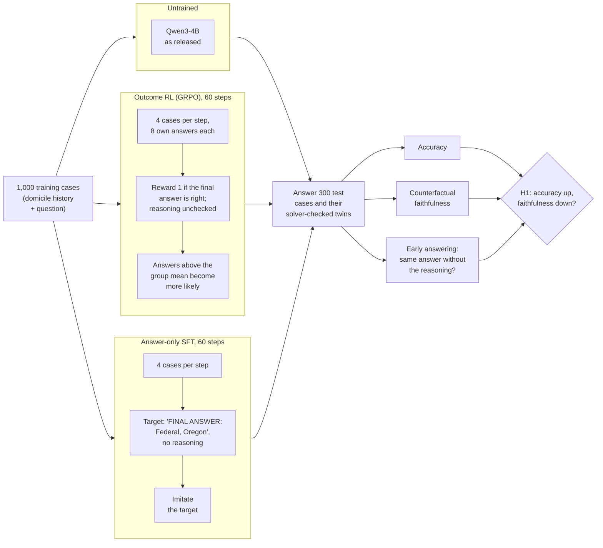

# Right Outcome, Wrong Reasons? Outcome vs. proof-step rewards for faithful statutory reasoning

Research proposal and pilot by Mert Ayvazoglu (M.Sc. Information Systems, TUM), October 2026.

**Question.** Does outcome-only reinforcement learning lower the causal faithfulness of LLM
reasoning on statutes, and do rewards for solver-verified proof steps prevent this at an acceptable
accuracy cost?

## Summary

- **Problem:** reasoning models are trained with outcome-only rewards: an answer earns full reward
  when it is right, whether or not the stated reasoning produced it. In law, where the stated grounds
  must be the operative ones, this can train models to be right for the wrong reasons.
- **Method:** on US bankruptcy rules that a solver can execute (OpenExempt, the 730-day domicile
  rule), Qwen3-4B is trained with outcome-only RL (GRPO) and with answer-only SFT. Faithfulness is
  measured with solver-verified twins (does the answer change exactly when the legal answer changes?)
  and by removing the model's own reasoning. Metrics and decision rule are pre-registered.
- **Finding:** training on answers raises accuracy without teaching the rule (answer-only SFT: 33% to
  73%; outcome RL: 55% in one seed, 34% in the other, so its gain is unstable over 60 steps). The SFT model mostly answers with the first state named in the text, a
  shortcut that is right on 86% of the cases; when the decisive date moves, its answer changes in 0% of
  the pairs (outcome RL: 21% and 11% in the two seeds, untrained: about 20 to 40%). Accuracy cannot see this; the twins can. The
  pre-registered balanced metric stays at chance and misses it: H1 as pre-registered is refuted
  (both seeds).
- **Contribution:** an open environment with solver-verified counterfactual twins on real statutes,
  pre-registered evaluation, and per-item records for every run.
- **Thesis:** outcome signals alone do not produce faithful statutory reasoning; the thesis tests
  whether rewards for solver-verified proof steps (H2) do.

## How the pilot works

The pilot asks one question: **when a model is trained only on whether its final answer is right,
does it learn the legal rule, or does it learn to guess right without following the rule?** Three
versions of the same model answer the same test cases:

- **Untrained (the reference point).** Qwen3-4B as released. Every effect is measured against it:
  "faithfulness drops" only means something if we know how faithful the model was before training.
- **Outcome RL (GRPO), the method under test.** The model writes its own reasoning and answer, 8 times
  per case, and is rewarded only for a correct final answer. This is how today's reasoning models are
  trained (reinforcement learning with verifiable rewards), and H1 claims it rewards right answers
  reached for the wrong reasons.
- **Answer-only SFT (the control).** The model is shown the correct answers for the same cases and
  learns to copy them, without any reinforcement learning. It receives the same information as GRPO
  (which answer is right) but learns it differently. If SFT shows the same loss of faithfulness, the
  cause is training on answers in general, not RL specifically.
- **What decides "faithful".** The rule is executable, so a solver knows for every case which facts
  matter. Each test case has twins in which one date is moved: if the legal answer changes, a faithful
  model must change its answer too; if it does not, the answer must stay. A model that guesses from
  surface cues fails this test even when its accuracy is high.

All three use the same frozen Qwen3-4B (4-bit); training changes only a small LoRA adapter (under 1%
of the parameters). They differ only in the training signal, and all are scored the same way.

- **Twins:** for each test case one move date is shifted. In an *operative* twin the solver's legal
  answer changes, so a model that applies the rule must change its answer; in an *invariant* twin it
  does not, so the answer must stay. Counterfactual faithfulness (CF) is the mean of both rates; 0.5
  is chance.
- **Early answering:** the model's own reasoning is cut to 0% or 50% and it is asked for the answer
  again. The same answer without the reasoning means the reasoning was not needed for it.
- **Thesis variant (H2, not in this pilot):** the same GRPO loop, but the reward credits each cited
  rule application that the solver re-executes and that belongs to the gold proof tree.

## Contents

| Path | What |
|---|---|
| `Expose_RLVR_Faithfulness_Ayvazoglu_v2.pdf`, `expose/expose_v2.tex` | current one-page exposé (v2, generic thesis version) |
| `Expose_CodeX_Stanford_Ayvazoglu.pdf`, `expose/expose.tex` | first version, written for the CodeX Stanford scholarship call |
| `pilot/` | H1 pilot: code, data, results ([pilot/README.md](pilot/README.md)) |

## Pilot result in one table

> **In one sentence:** training on correct answers makes the model score higher **without learning
> the legal rule**. The answer-only model reaches 73% by picking *the first state named in the text*,
> and stops reacting to the date that decides the case.

| | Untrained | Outcome RL, seed 1 | Outcome RL, seed 2 | Answer-only SFT |
|---|---|---|---|---|
| **Accuracy** | 33% | **55%** | 34% | **73%** |
| Answers equal "first state named" (a shortcut, legally correct 86% of the time) | 32% | 60% | 35% | **84%** |
| **Answer changes when the decisive date moves** (should be 100%) | | 38% → **21%** | 21% → **11%** | 39% → **0%** |
| Answer stays when an irrelevant date moves (should be 100%) | | 63% → 79% | 67% → 83% | 51% → 98% |
| Balanced CF, the pre-registered metric (0.5 = chance) | | 0.51 → 0.50 | 0.44 → 0.47 | 0.45 → 0.49 |
| Pre-registered verdict for H1 | | refuted | refuted | (control) |
| Same answer with the reasoning removed | 6% | 26% | 16% | 92%¹ |

Rows 3 to 5 compare each model with the untrained model on the cases both answer correctly (before →
after; 19 to 29 operative pairs per comparison, so these rows are descriptive). Seed 1 ran on a Colab T4,
seed 2 and SFT on a Modal L4, each compared with the untrained model on the same machine. ¹ The SFT model was trained to answer without reasoning, so this row says little for it.

**Findings**
1. **Accuracy can rise, the rule is not learned.** Answer-only SFT raises accuracy strongly; outcome
   RL does so in one of two seeds (55% vs 34%; with 60 steps its gain depends on the random seed).
   No trained model follows the date that decides the case more than the untrained one.
2. **The shortcut has a name.** "Take the first state named" ignores the dates but is right on 86% of
   the test cases (an artefact of how OpenExempt generates cases). 84% of the SFT model's answers
   and 60% of the GRPO model's answers coincide with it (`pilot/results/shortcut_analysis.md`,
   descriptive).
3. **Only the twins reveal it.** On accuracy, the shortcut model looks best. On the twins it never
   changes its answer when the legal answer changes.
4. **H1 as pre-registered is refuted; the summary metric hides the pattern.** Both seeds count as
   *refuted*: balanced CF stays near 0.5, because a model that never changes its answer keeps every
   invariant twin. The operative row is the informative one: in both seeds and in SFT the trained
   model reacts less to the decisive date, even in seed 2, whose accuracy barely rose (descriptive).
5. **Not specific to RL.** Answer-only SFT shows the effect more strongly than outcome RL, so the cause
   is training on answers, not reinforcement learning as such.

**Running (19 October):** the H2 pilot (proof-step rewards,
[`pilot/PREREGISTRATION_H2.md`](pilot/PREREGISTRATION_H2.md)) on Modal.
Records and analyses: [`pilot/results/`](pilot/results/), details in [pilot/README.md](pilot/README.md).

## License and credits

Code: MIT (see `LICENSE`). The pilot data in `pilot/data/` and `pilot/colab/pilot_data.zip` is
generated with the [OpenExempt](https://github.com/servantez/OpenExempt) framework (Servantez,
Lawsky, Jain, Linna, Hammond; Findings of ACL 2026), licensed CC BY 4.0, and remains under that
licence.
