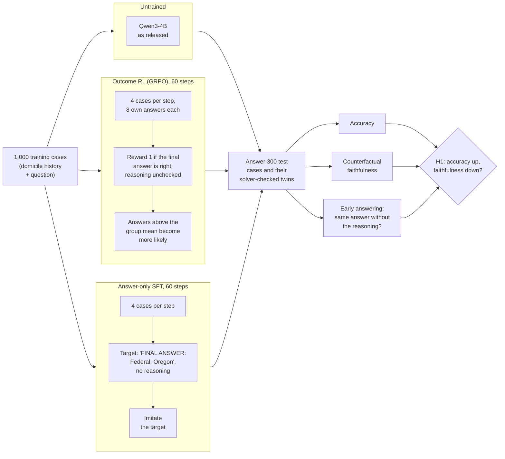

# Right Outcome, Wrong Reasons? Outcome vs. proof-step rewards for faithful statutory reasoning

Research proposal and pilot by Mert Ayvazoglu (M.Sc. Information Systems, TUM), October 2026.

**Question.** Does outcome-only reinforcement learning lower the causal faithfulness of LLM
reasoning on statutes, and do rewards for solver-verified proof steps prevent this at an acceptable
accuracy cost?

## Summary

- **Problem:** reasoning models are trained with outcome-only rewards: an answer earns full reward
  when it is right, whether or not the stated reasoning produced it. In law, where the stated grounds
  must be the operative ones, this can train models to be right for the wrong reasons.
- **Method:** on US bankruptcy rules that a solver can execute (OpenExempt, the 730-day domicile
  rule), Qwen3-4B is trained with outcome-only RL (GRPO) and with answer-only SFT. Faithfulness is
  measured with solver-verified twins (does the answer change exactly when the legal answer changes?)
  and by removing the model's own reasoning. Metrics and decision rule are pre-registered.
- **Finding:** training raises accuracy (33% to 55% with GRPO, 73% with SFT) but does not teach the
  rule. On cases both models answer correctly, the GRPO model reacts less to every date edit, decisive
  or not, so balanced CF stays at chance (0.51 to 0.50; seed 1 refuted under the pre-registered rule,
  seed 2 pending). SFT is the extreme case: 73% correct while its answer follows a decisive date change
  in 2.5% of pairs. Answers increasingly come without the stated reasoning (6% to 26% with GRPO).
- **Contribution:** an open environment with solver-verified counterfactual twins on real statutes,
  pre-registered evaluation, and per-item records for every run.
- **Thesis:** outcome signals alone do not produce faithful statutory reasoning; the thesis tests
  whether rewards for solver-verified proof steps (H2) do.

## How the pilot works

All arms use the same frozen Qwen3-4B (4-bit); training changes only a small LoRA adapter (under 1% of
the parameters). The arms differ only in the training signal, and all are scored the same way.

- **Twins:** for each test case one move date is shifted. In an *operative* twin the solver's legal
  answer changes, so a model that applies the rule must change its answer; in an *invariant* twin it
  does not, so the answer must stay. Counterfactual faithfulness (CF) is the mean of both rates; 0.5
  is chance.
- **Early answering:** the model's own reasoning is cut to 0% or 50% and it is asked for the answer
  again. The same answer without the reasoning means the reasoning was not needed for it.
- **Thesis variant (H2, not in this pilot):** the same GRPO loop, but the reward credits each cited
  rule application that the solver re-executes and that belongs to the gold proof tree.

## Contents

| Path | What |
|---|---|
| `Expose_RLVR_Faithfulness_Ayvazoglu_v2.pdf`, `expose/expose_v2.tex` | current one-page exposé (v2, generic thesis version) |
| `Expose_CodeX_Stanford_Ayvazoglu.pdf`, `expose/expose.tex` | first version, written for the CodeX Stanford scholarship call |
| `pilot/` | H1 pilot: code, data, results ([pilot/README.md](pilot/README.md)) |

## Pilot result in one table

Qwen3-4B, outcome-reward GRPO, 60 steps, one seed, OpenExempt Task AE, 300 test cases.

| | Base | After 60 steps |
|---|---|---|
| Accuracy | 33.3% | 55.3% |
| Answer changes when the legally decisive date changes | 46% | 25% |
| Same answer with the reasoning removed | 6% | 24% |
| Counterfactual faithfulness (balanced, 0.5 = chance) | 0.54 | 0.50 |

Exploratory run, one seed. Accuracy rose while the model tracked the operative fact less and
relied less on its stated reasoning. The CF figures are computed on each model's own correct items,
not on jointly correct items as planned, and the 4.4-point drop falls in the range where the rule
written before the run asks for another seed: **H1 is pending.** Confirmatory reruns are specified
in [pilot/PREREGISTRATION.md](pilot/PREREGISTRATION.md). Details in [pilot/README.md](pilot/README.md).

## License and credits

Code: MIT (see `LICENSE`). The pilot data in `pilot/data/` and `pilot/colab/pilot_data.zip` is
generated with the [OpenExempt](https://github.com/servantez/OpenExempt) framework (Servantez,
Lawsky, Jain, Linna, Hammond; Findings of ACL 2026), licensed CC BY 4.0, and remains under that
licence.
