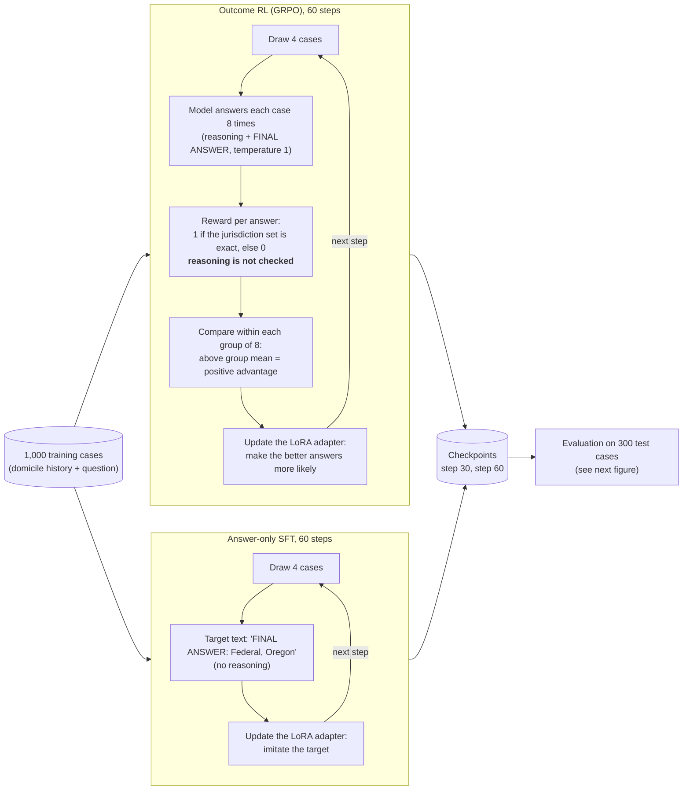
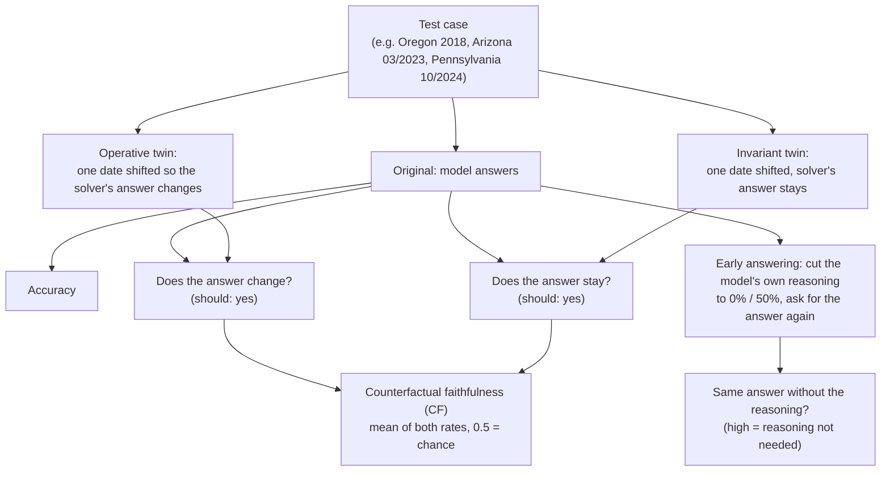

# Right Outcome, Wrong Reasons? Outcome vs. proof-step rewards for faithful statutory reasoning

Research proposal and pilot by Mert Ayvazoglu (M.Sc. Information Systems, TUM), October 2026.

**Question.** Does outcome-only reinforcement learning lower the causal faithfulness of LLM
reasoning on statutes, and do rewards for solver-verified proof steps prevent this at an acceptable
accuracy cost?

## Contents

| Path | What |
|---|---|
| `Expose_RLVR_Faithfulness_Ayvazoglu_v2.pdf`, `expose/expose_v2.tex` | current one-page exposé (v2, generic thesis version) |
| `Expose_CodeX_Stanford_Ayvazoglu.pdf`, `expose/expose.tex` | first version, written for the CodeX Stanford scholarship call |
| `pilot/` | H1 pilot: code, data, results ([pilot/README.md](pilot/README.md)) |

## How the pilot works

All arms train only a small LoRA adapter (rank 16, under 1% of the parameters) on a frozen 4-bit
Qwen3-4B. The arms differ in the training signal.

The thesis variant (H2, not part of this pilot) changes only the reward box of the GRPO loop: it
credits each cited rule application that the solver re-executes and that belongs to the gold proof
tree, instead of the final answer alone.

## Pilot result in one table

Qwen3-4B, outcome-reward GRPO, 60 steps, one seed, OpenExempt Task AE, 300 test cases.

| | Base | After 60 steps |
|---|---|---|
| Accuracy | 33.3% | 55.3% |
| Answer changes when the legally decisive date changes | 46% | 25% |
| Same answer with the reasoning removed | 6% | 24% |
| Counterfactual faithfulness (balanced, 0.5 = chance) | 0.54 | 0.50 |

Exploratory run, one seed. Accuracy rose while the model tracked the operative fact less and
relied less on its stated reasoning. The CF figures are computed on each model's own correct items,
not on jointly correct items as planned, and the 4.4-point drop falls in the range where the rule
written before the run asks for another seed: **H1 is pending.** Confirmatory reruns are specified
in [pilot/PREREGISTRATION.md](pilot/PREREGISTRATION.md). Details in [pilot/README.md](pilot/README.md).

## License and credits

Code: MIT (see `LICENSE`). The pilot data in `pilot/data/` and `pilot/colab/pilot_data.zip` is
generated with the [OpenExempt](https://github.com/servantez/OpenExempt) framework (Servantez,
Lawsky, Jain, Linna, Hammond; Findings of ACL 2026), licensed CC BY 4.0, and remains under that
licence.
