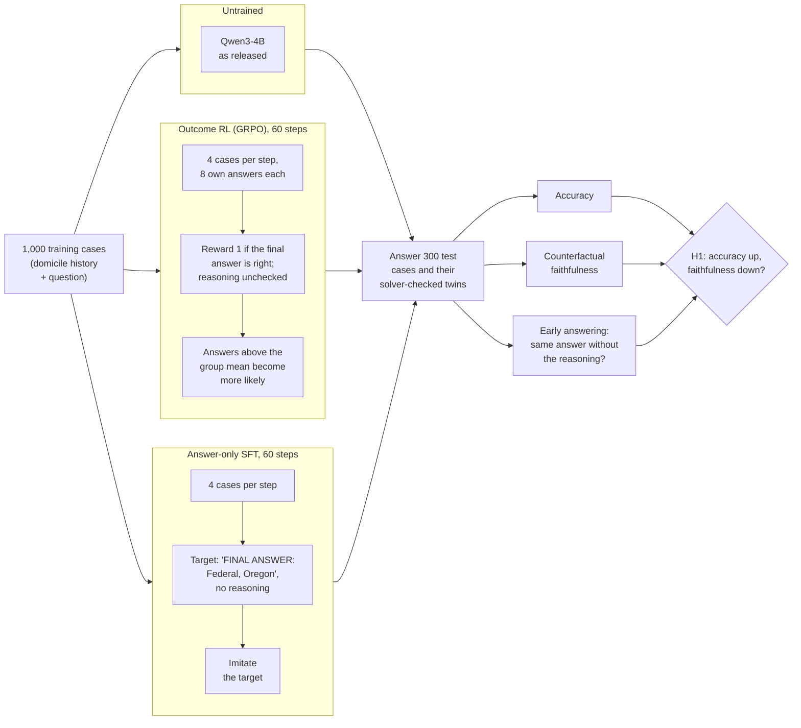

# Right Outcome, Wrong Reasons? Outcome vs. proof-step rewards for faithful statutory reasoning

Pilot study by Mert Ayvazoglu (M.Sc. Information Systems, TUM), October 2026.

**Question.** Does training on right answers teach a language model the legal rule behind them, and
do rewards for solver-checked reasoning steps do better?

## Summary

- **Problem:** reasoning models are trained with outcome-only rewards: a right answer earns full
  reward, whatever reasoning led to it. In law, the stated reasons must be the ones that decided.
- **Method:** Qwen3-4B learns a US bankruptcy rule (OpenExempt, the 730-day domicile rule) by outcome
  RL (GRPO) or by copying correct answers (SFT). Solver-checked twins test whether its answers follow
  the facts that decide the case. Metrics and decision rule are pre-registered.
- **Finding:** training on answers raises accuracy without teaching the rule. The SFT model reaches
  73% mostly by naming the first state in the text, and its answer never follows the deciding date.
  Outcome RL gains accuracy in one of two seeds and also reacts less to that date. H1 as
  pre-registered is refuted: its summary metric stays at chance.
- **Contribution:** solver-checked twins on real statutes, a pre-registered evaluation, and
  per-item records for every run.
- **H2 pilots:** two versions of a reward for solver-checked proof steps did not help (not
  promising as pre-registered). In the second, the models wrote derivations the solver accepts and
  copied them unchanged when the deciding date moved: correct steps, still the shortcut. Training
  data where the shortcuts do not pay (H2c) kept more correct derivations but did not fix this.
- **Thesis:** separate the date arithmetic from the legal rule (date tool or larger model), then
  compare outcome and step rewards on data and twins where the shortcuts fail.

## How the pilot works

Does a model trained only on right answers learn the legal rule, or learn to guess right? Three
versions of the same model answer the same 300 test cases:

- **Untrained:** Qwen3-4B as released; the baseline for every comparison.
- **Outcome RL (GRPO):** the model writes reasoning and an answer 8 times per case and is rewarded
  for a correct answer only. Current reasoning models are trained this way.
- **Answer-only SFT (control):** the model copies the correct answers. Same information, no RL, so
  it shows whether an effect comes from RL or from training on answers at all.

All three use the same frozen 4-bit Qwen3-4B; training changes a LoRA adapter (under 1% of the weights).

- **Twins:** each test case has copies in which one date moves. If the solver's answer changes
  (operative twin), a model that applies the rule must change its answer; if not (invariant twin),
  it must keep it.
- **Early answering:** the model's own reasoning is cut to 0% or 50%. The same answer anyway means
  the reasoning was not needed.
- **H2, H2b and H2c (below the table):** the same GRPO loop, with a reward that also checks each cited
  rule step against the solver.

## Contents

| Path | What |
|---|---|
| `pilot/` | code, data, pre-registrations and results ([pilot/README.md](pilot/README.md)) |

## Pilot result in one table

> **In one sentence:** the trained models can score higher without learning the rule. Answer-only
> SFT reaches 73% by naming the first state in the text and never reacts to the date that decides
> the case.

| | Untrained | Outcome RL, seed 1 | Outcome RL, seed 2 | Answer-only SFT |
|---|---|---|---|---|
| **Accuracy** | 33% | **55%** | 34% | **73%** |
| Answer = first state named¹ | 32% | 60% | 35% | **84%** |
| **Answer changes when the deciding date moves** (should be 100%)² | | 38% → **21%** | 21% → **11%** | 39% → **0%** |
| Answer stays when an irrelevant date moves (should be 100%)² | | 63% → 79% | 67% → 83% | 51% → 98% |
| Balanced CF, pre-registered (0.5 = chance)² | | 0.51 → 0.50 | 0.44 → 0.47 | 0.45 → 0.49 |
| H1 verdict (pre-registered) | | refuted | refuted | control |
| Same answer without the reasoning | 6% | 26% | 16% | 92%³ |

¹ Picks the first state in the text and ignores the dates; legally right on 86% of the test cases.
² On cases both the untrained and the trained model answer correctly, before → after; 19 to 29
operative pairs each, so descriptive. Seed 1 ran on a Colab T4, the others on a Modal L4, each
against an untrained run on the same machine.
³ SFT was trained to answer without reasoning.

**Findings**
1. **Accuracy hides a shortcut.** SFT reaches 73% by naming the first state in the text, which the
   OpenExempt generator makes right 86% of the time. Only the twins show that its answer never
   follows the deciding date.
2. **Outcome RL is unstable and does not learn the rule either.** One seed reaches 55%, the other
   34%. Both react less to the deciding date afterwards, even the seed whose accuracy barely moved.
3. **H1 as pre-registered is refuted.** Its metric, balanced CF, averages two rates; a model that
   never changes its answer keeps every invariant twin and lands at 0.5. The operative row carries
   the signal.
4. **The cause is training on answers.** SFT shows the effect more strongly than outcome RL.

**H2 pilot (proof-step rewards, [`pilot/PREREGISTRATION_H2.md`](pilot/PREREGISTRATION_H2.md)): not
promising.** With the same step-citing prompt, rewarding solver-checked steps instead of the answer
alone did not change the twin result (CF −1.4 points, CI −12..+10) and cost 10 points of accuracy.
The model learned to cite the easy steps and earned partial credit for them, but not the 180-day
computation that decides most cases (fully correct derivations 11% → 15%). Descriptively, both trained
models reacted *more* to the deciding date than the untrained one when asked to cite steps
([`pilot/results/h2/VERDICT.md`](pilot/results/h2/VERDICT.md)).

**H2b pilot (finer step reward after an SFT warm start, two seeds,
[`pilot/PREREGISTRATION_H2B.md`](pilot/PREREGISTRATION_H2B.md)): not promising.** Process vs outcome
reward: CF −0.7 and −1.5 points, same accuracy. Both rewards led to the shortcut. The four trained
models answer with the first state named in 94 to 100% of cases, and their accuracy (83 to 86%) is
that shortcut's 86%. Their derivations look right: the solver accepts 70 to 76% as fully correct.
When the deciding date moves, the process-reward models cite the same steps, day counts included,
in every case. For originals with a perfect derivation, the twin's derivation is never correct (0 of
61 to 66 per run). A step reward checked against the solver also pays for a template, as long as
the training cases do not separate the rule from the shortcut
([`pilot/results/h2b/VERDICT.md`](pilot/results/h2b/VERDICT.md)).

**H2c pilot (H2b on training data where the shortcuts do not pay,
[`pilot/PREREGISTRATION_H2C.md`](pilot/PREREGISTRATION_H2C.md)): not promising, and the balanced
data did not help either.** Each shortcut was right on 56% of training cases instead of 80 to 90%.
Process vs outcome reward: CF +1.5 and −1.6 points. Against H2b, twin-consistent accuracy fell by
3.8 points on average. One thing changed: on the 42 test cases where the first state is wrong, H2b's
trained models had no correct derivation left, while three of the four H2c models kept 8 to 19. But
when the deciding date moves, they still cite the same steps in 88 to 95% of cases. The derivations
are not computed from the dates, so the next test separates the date arithmetic from the rule
([`pilot/results/h2c/VERDICT.md`](pilot/results/h2c/VERDICT.md)).

Records and analyses in [`pilot/results/`](pilot/results/); details in [pilot/README.md](pilot/README.md).

## License and credits

Code: MIT (see `LICENSE`). The pilot data in `pilot/data/` and `pilot/colab/pilot_data.zip` is
generated with the [OpenExempt](https://github.com/servantez/OpenExempt) framework (Servantez,
Lawsky, Jain, Linna, Hammond; Findings of ACL 2026), licensed CC BY 4.0, and remains under that
licence.
