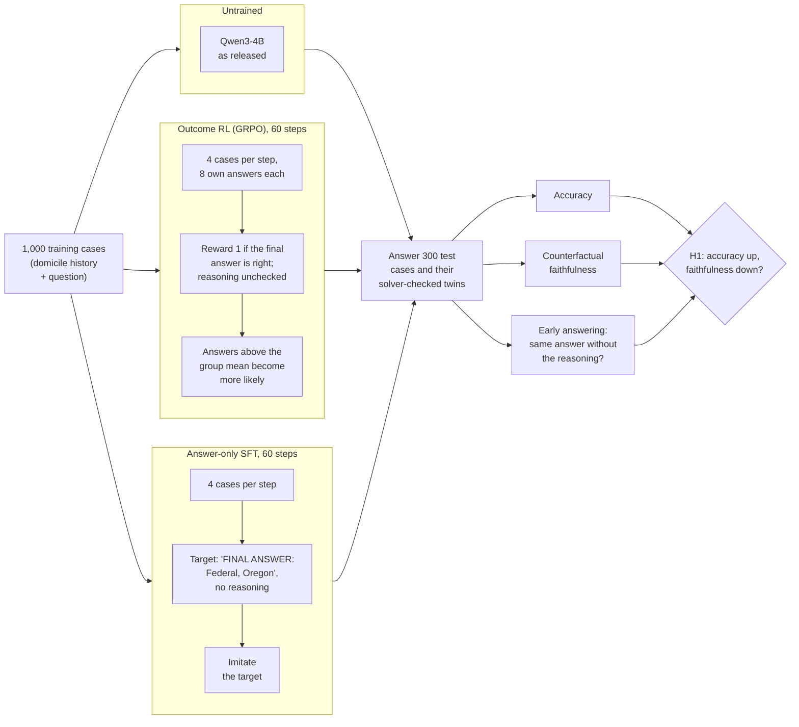

# Right Outcome, Wrong Reasons? Outcome vs. proof-step rewards for faithful statutory reasoning

Pilot study by Mert Ayvazoglu (M.Sc. Information Systems, TUM), October 2026.

**Question.** Does training on right answers teach a language model the legal rule behind them, and
do rewards for solver-checked reasoning steps do better?

## Summary

- **Problem:** reasoning models are trained with outcome-only rewards: a right answer earns full
  reward, whatever reasoning led to it. In law, the stated reasons must be the ones that decided.
- **Method:** Qwen3-4B learns a US bankruptcy rule (OpenExempt, the 730-day domicile rule) by outcome
  RL (GRPO) or by copying correct answers (SFT). Solver-checked twins test whether its answers follow
  the facts that decide the case. Metrics and decision rule are pre-registered.
- **Finding:** training on answers raises accuracy without teaching the rule. The SFT model reaches
  73% mostly by naming the first state in the text, and its answer never follows the deciding date.
  Outcome RL gains accuracy in one of two seeds and also reacts less to that date. H1 as
  pre-registered is refuted: its summary metric stays at chance.
- **Contribution:** solver-checked twins on real statutes, a pre-registered evaluation, and
  per-item records for every run.
- **Thesis:** test whether rewards for solver-checked proof steps (H2) teach the rule.

## How the pilot works

Does a model trained only on right answers learn the legal rule, or learn to guess right? Three
versions of the same model answer the same 300 test cases:

- **Untrained:** Qwen3-4B as released; the baseline for every comparison.
- **Outcome RL (GRPO):** the model writes reasoning and an answer 8 times per case and is rewarded
  for a correct answer only. Current reasoning models are trained this way.
- **Answer-only SFT (control):** the model copies the correct answers. Same information, no RL, so
  it shows whether an effect comes from RL or from training on answers at all.

All three use the same frozen 4-bit Qwen3-4B; training changes a LoRA adapter (under 1% of the weights).

- **Twins:** each test case has copies in which one date moves. If the solver's answer changes
  (operative twin), a model that applies the rule must change its answer; if not (invariant twin),
  it must keep it.
- **Early answering:** the model's own reasoning is cut to 0% or 50%. The same answer anyway means
  the reasoning was not needed.
- **H2 (running, not in the table):** the same GRPO loop, with a reward that also checks each cited
  rule step against the solver.

## Contents

| Path | What |
|---|---|
| `pilot/` | code, data, pre-registrations and results ([pilot/README.md](pilot/README.md)) |

## Pilot result in one table

> **In one sentence:** the trained models can score higher without learning the rule. Answer-only
> SFT reaches 73% by naming the first state in the text and never reacts to the date that decides
> the case.

| | Untrained | Outcome RL, seed 1 | Outcome RL, seed 2 | Answer-only SFT |
|---|---|---|---|---|
| **Accuracy** | 33% | **55%** | 34% | **73%** |
| Answer = first state named¹ | 32% | 60% | 35% | **84%** |
| **Answer changes when the deciding date moves** (should be 100%)² | | 38% → **21%** | 21% → **11%** | 39% → **0%** |
| Answer stays when an irrelevant date moves (should be 100%)² | | 63% → 79% | 67% → 83% | 51% → 98% |
| Balanced CF, pre-registered (0.5 = chance)² | | 0.51 → 0.50 | 0.44 → 0.47 | 0.45 → 0.49 |
| H1 verdict (pre-registered) | | refuted | refuted | control |
| Same answer without the reasoning | 6% | 26% | 16% | 92%³ |

¹ Picks the first state in the text and ignores the dates; legally right on 86% of the test cases.
² On cases both the untrained and the trained model answer correctly, before → after; 19 to 29
operative pairs each, so descriptive. Seed 1 ran on a Colab T4, the others on a Modal L4, each
against an untrained run on the same machine.
³ SFT was trained to answer without reasoning.

**Findings**
1. **Accuracy hides a shortcut.** SFT reaches 73% by naming the first state in the text, which the
   OpenExempt generator makes right 86% of the time. Only the twins show that its answer never
   follows the deciding date.
2. **Outcome RL is unstable and does not learn the rule either.** One seed reaches 55%, the other
   34%. Both react less to the deciding date afterwards, even the seed whose accuracy barely moved.
3. **H1 as pre-registered is refuted.** Its metric, balanced CF, averages two rates; a model that
   never changes its answer keeps every invariant twin and lands at 0.5. The operative row carries
   the signal.
4. **The cause is training on answers.** SFT shows the effect more strongly than outcome RL.

Running: the H2 pilot ([`pilot/PREREGISTRATION_H2.md`](pilot/PREREGISTRATION_H2.md)) on Modal.
Records and analyses in [`pilot/results/`](pilot/results/); details in [pilot/README.md](pilot/README.md).

## AI use

Code, analyses and text were developed with Claude Code as a programming and writing assistant.
Research question, study design, pre-registration and interpretation were discussed and decided by
the author; all numbers are computed from the published records.

## License and credits

Code: MIT (see `LICENSE`). The pilot data in `pilot/data/` and `pilot/colab/pilot_data.zip` is
generated with the [OpenExempt](https://github.com/servantez/OpenExempt) framework (Servantez,
Lawsky, Jain, Linna, Hammond; Findings of ACL 2026), licensed CC BY 4.0, and remains under that
licence.
