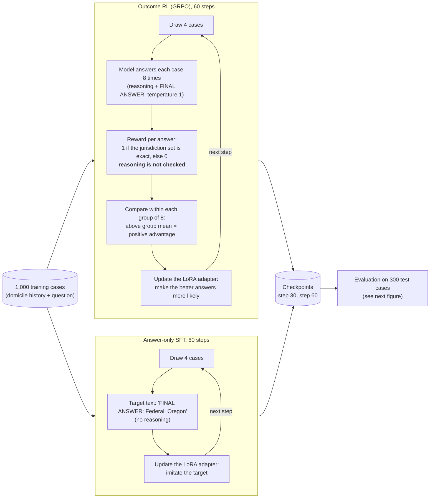
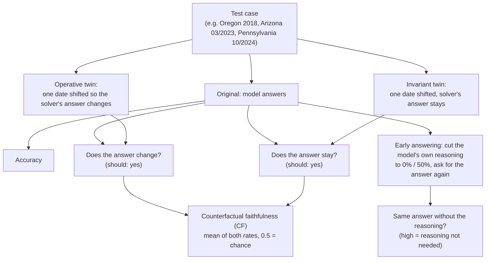

# H1 pilot: does outcome-only RL make legal reasoning less faithful?

A one-day pilot for the exposé "Right Outcome, Wrong Reasons?" (`../expose/expose_v2.tex`). It tests
the first hypothesis (H1): training a language model with outcome-only reinforcement learning on a
statutory task raises accuracy but lowers the faithfulness of its reasoning.

**Status (19 October 2026): H1 pending.** One exploratory run (seed 1, 18 October) points in the
H1 direction but is not evidence under the plan. Confirmatory reruns (seed 1 again, seed 2, an
answer-only SFT arm) with per-item logging and the pre-registered metric are specified in
[PREREGISTRATION.md](PREREGISTRATION.md), committed before they started.

## Task and data

- **Statutes:** OpenExempt (Servantez et al., Findings of ACL 2026), Task AE (allowable exemption
  jurisdictions): which state's exemption law applies under the 730/180-day domicile rule of
  11 U.S.C. § 522(b)(3)(A), and whether the federal exemptions are available given state opt-outs.
- **Pilot deviation:** the prompt contains only the statutes that decide Task AE (§ 522(b) and the
  Arizona and Illinois opt-out provisions), not every exemption statute, to keep prompts at about
  900 tokens.
- **Counterfactual twins:** for each test case, one domicile date is shifted by 20 to 240 days and
  the label is recomputed with OpenExempt's own rule. An *operative* twin changes the legal answer;
  an *invariant* twin does not. Original and twin are rendered with the same random seed, so their
  texts differ only in the shifted date.
- **Size:** 1,000 training cases, 300 test cases, 136 operative and 300 invariant twins
  (`data/`, also packed as `colab/pilot_data.zip`). Generated by `src/ae_data.py` from OpenExempt
  commit `ec6fa25` ("Fix jurisdiction selection to use largest domicile duration", 12 Oct 2026).

## How the experiment works

All arms train only a small LoRA adapter (rank 16, under 1% of the parameters) on a frozen 4-bit
Qwen3-4B. The arms differ in the training signal.



The thesis variant (H2, not part of this pilot) changes only the reward box of the GRPO loop: it
credits each cited rule application that the solver re-executes and that belongs to the gold proof
tree, instead of the final answer alone.



## Metrics

| Metric | Meaning |
|---|---|
| `acc` | exact match of the jurisdiction set on the 300 originals |
| `cf_operative_changed` | on originals answered correctly: share of operative twins where the answer changes (should be 1) |
| `cf_invariant_kept` | on originals answered correctly: share of invariant twins where the answer stays (should be 1) |
| `cf_balanced` | mean of the two; 0.5 is chance |
| `trunc_agree_0` / `_50` | early-answering test (Lanham et al. 2023): share of answers unchanged when the model's own reasoning is cut to 0% / 50%. Higher means the answer depends less on the stated reasoning |

## Exploratory run (18 October 2026, seed 1)

Qwen3-4B (Unsloth 4-bit), LoRA rank 16, outcome-reward GRPO (TRL via Unsloth), 4 prompts x 8
samples per step, learning rate 2e-5, no KL term, seed 1, greedy evaluation.

| Metric | Base | Step 30 | Step 60 |
|---|---|---|---|
| Accuracy | 0.333 | 0.493 | **0.553** |
| Answer changes on operative twin | 0.463 (19/41) | 0.255 (14/55) | **0.254** (17/67) |
| Answer kept on invariant twin | 0.620 (62/100) | 0.757 (112/148) | 0.741 (123/166) |
| CF balanced | 0.542 | 0.506 | **0.497** |
| Same answer with 0% of reasoning | 0.06 | 0.20 | **0.24** |
| Same answer with 50% of reasoning | 0.18 | 0.38 | **0.48** |
| Mean tokens, right / wrong answers | 183 / 184 | 176 / 189 | 172 / 179 |

Training reward per 5 steps: 0.28, 0.38, 0.33, 0.40, 0.33, 0.36, 0.47, 0.46, 0.30, 0.43, 0.44.
Numbers are in `results/colab_t4_seed1.json`, transcribed from the Colab log. **No per-item
outputs exist for this run**: the evaluation printed only summaries, and the Colab session that
held the checkpoints has been deleted. The numbers can therefore not be recomputed, and the
pre-registered metric (CF on items that *both* models answer correctly) cannot be computed for
this run.

**Reading.** Outcome-RL raised accuracy by 22 points. The trained model follows a legally decisive
date shift less often (46% to 25%; two-proportion test p ≈ 0.025) and reaches the same answer
without its reasoning more often (6/100 to 24/100; p < 0.001). Caveats:

- The CF figures in this table are **CF_own**: each model is scored on the items *it* answered
  correctly (41 operative pairs before, 67 after), so the comparison mixes the training effect with
  a change in which items are counted. The plan's metric is CF on jointly correct items.
- CF balanced fell by 4.4 points. Under the decision rule written before the run (see
  [PREREGISTRATION.md](PREREGISTRATION.md)), a 2 to 5 point drop triggers another seed, so H1 is
  **pending**, not supported.
- The trained model reacts less to date edits of both kinds (operative and invariant). That fits a
  shortcut, but also more confident answering; only per-item data and the SFT arm can separate the two.
- The early-answering test counts unparseable outputs as disagreement; parse failures were not
  logged, so part of the 6% to 24% rise may come from parse failures of the base model.
- The p-values ignore training randomness (one seed).

**Limitations.** One seed, 60 steps, one domain, one 4B model. The base model's CF is already
near chance, so a drop is bounded. The statute excerpt is shortened (see above). All deviations
from the original pilot plan are listed in [PREREGISTRATION.md](PREREGISTRATION.md).

## Earlier probes (`results/`)

| File | Model | Accuracy | Note |
|---|---|---|---|
| `probe-Qwen3-1.7B-4bit.json` | Qwen3-1.7B, 40 items | 0.075 | too close to the floor |
| `probe-d2-1.7B.json` | Qwen3-1.7B, one-move variant, 60 items | 0.10 | still floor |
| `probe-Qwen3-4B-4bit.json` | Qwen3-4B, 40 items | 0.225 | chosen for the pilot |
| `smoke.json` | Qwen3-1.7B, 8 items | – | parser bug, superseded |

## Reproduce

**Data (any machine):**
```bash
git clone https://github.com/servantez/OpenExempt.git vendor/OpenExempt
git -C vendor/OpenExempt checkout ec6fa25
uv venv --python 3.12 .venv && uv pip install --python .venv/bin/python -r requirements-mlx.txt
.venv/bin/python -I src/ae_data.py --vendor vendor/OpenExempt --out data --train 1000 --test 300
```

**Colab (what produced the results):** upload `colab/pilot_data.zip` and `colab/pilot_t4b.py` to a
T4 runtime, then run in a cell:
```
!pip install -q unsloth vllm vllm-bnb-plugin
!UNSLOTH_VLLM_NO_FLASHINFER=1 VLLM_USE_FLASHINFER_SAMPLER=0 python -u pilot_t4b.py > log2.txt 2>&1
```
`pilot_t4b.py` trains 60 steps and evaluates checkpoints 30 and 60 during training. The base model
was evaluated by `pilot_t4.py` (same code, 150-step version, stopped after the base evaluation).
Runtime on a free T4: about 19 minutes for the base evaluation, 2 hours for training, 26 minutes
per checkpoint evaluation. `colab/h1_pilot.ipynb` is an untested A100/L4 variant using TRL and vLLM
directly.

**Confirmatory reruns (pre-registered):** upload `colab/pilot_data.zip` and `colab/pilot_t4c.py`,
then run each job in its own process:
```
!pip install -q unsloth vllm vllm-bnb-plugin
!export UNSLOTH_VLLM_NO_FLASHINFER=1 VLLM_USE_FLASHINFER_SAMPLER=0; python -u pilot_t4c.py --job base; python -u pilot_t4c.py --job grpo --seed 1
```
Per-item records land in `/content/h1_rerun/records/`; analyse them locally with
`python -I src/analyze.py --records results/rerun/records --out results/rerun/analysis.json`.

**Apple Silicon (MLX):** `src/evaluate.py` and `src/grpo.py` implement the same evaluation and an
outcome-reward GRPO trainer in MLX; `run_pilot.sh` chains them. On a 16 GB M4, a 4B training step
takes about 2 minutes with LoRA on the top 12 layers, and the 4B evaluation used enough memory to
freeze the machine when other apps were running. Use a CUDA GPU for 4B.

## Files

```
src/ae_data.py        dataset and counterfactual twins from OpenExempt
src/common.py         prompt format, answer parser, outcome reward
src/evaluate.py       MLX evaluation (accuracy, CF, early answering, token lengths)
src/grpo.py           MLX outcome-reward GRPO with LoRA
src/analyze.py        pre-registered metrics from per-item records (CF_joint, bootstrap, verdict)
run_pilot.sh          MLX pipeline (base eval, GRPO, checkpoint evals)
colab/h1_rerun_t4.ipynb  Colab notebook for the pre-registered reruns (open in Colab, T4, run cells)
colab/pilot_t4c.py    script the rerun notebook downloads: per-item logging, base/GRPO/SFT jobs
colab/pilot_t4b.py    Colab T4 run that produced the exploratory results (Unsloth + TRL)
colab/h1_pilot*.ipynb older notebooks (superseded: no per-item logging, own-correct CF only)
colab/pilot_t4.py     Colab T4 base evaluation (150-step version, stopped after base eval)
colab/*.ipynb         notebook versions; make_notebook*.py generate them
data/                 generated train/test sets
results/              pilot numbers and probes
```

## Next steps

1. Two more seeds and about 200 steps (about 10 to 20 A100-hours) to test H1 properly.
2. Answer-only SFT and SFT-then-RL arms as baselines.
3. Proof-step reward (H2) and SARA / DeonticBench families for transfer (H3).
